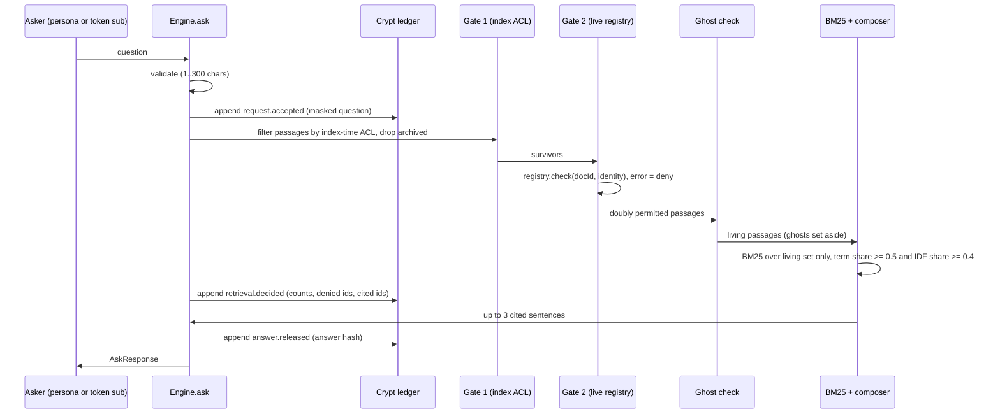

# Design: permission gates and the stitched answer

## Pipeline (single source of truth: `src/engine/engine.ts`)



If any ledger append throws, `ask` returns `{ status: "ledger_unavailable" }` and nothing else.

## Interfaces

```ts
interface Identity { userId: string; groups: string[] }
interface AclRegistry { check(docId: string, who: Identity): boolean } // may throw
interface Citation { n: number; passageId: string; kind: SourceKind; title: string; location: string;
  version: number; updatedAt: string; checkedAt: string; dusty: boolean }
interface AnswerSentence { text: string; citations: number[] }
type AskResponse =
  | { status: "answered"; requestId: string; sentences: AnswerSentence[]; citations: Citation[]; ghosts: GhostNote[] }
  | { status: "no_answer"; requestId: string; message: string; sentences: []; citations: []; ghosts: GhostNote[] }
  | { status: "invalid_query"; message: string }
  | { status: "ledger_unavailable"; message: string };
```

The engine takes injected `clock()` and `newId()` functions so tests can compare responses exactly.

## Why statistics are computed after both gates

BM25 IDF depends on how many documents contain a term. If restricted documents counted, a person could detect a restricted document by watching scores move. Computing statistics over the doubly permitted living set makes Requirement 5 hold by construction. The corpus is small (under 1,000 passages), so this per-request computation is cheap. At larger scale Gate 2 would run on the top N candidates and statistics would come from a per-group index; that is designed, not built.

## Relevance rule

A passage is relevant only if it contains at least half of the distinct query terms and at least 40 percent of the query's total IDF weight (IDF computed over the asker's living set, with unseen terms at maximum weight). The first rule stops one-word matches on long questions; the second stops a common word ("work") from standing in for a rare one ("remotely"). Interrogative filler (`must`, `need`, `fast`, `quickly`) is in the stop list. Each answer sentence is the best matching sentence of its passage; if that sentence only repeats the title (a ticket summary), the best non-title sentence is appended.

## API (`server/handler.ts`, bundled to `api/_lib/stitchwork-api.mjs`, wrapped by `api/*.js`)

| Route | Method | Body | Response |
|---|---|---|---|
| `/api/health` | GET | none | `{ ok, configured }` |
| `/api/session` | POST | `{ persona }` | `{ token, expiresIn: 900, persona }` |
| `/api/ask` | POST | `{ question }`, header `Authorization: Bearer <token>` | `AskResponse` plus `cryptSealed` (a count); `crypt` entries only for a steward |

Token format: `base64url(JSON {sub, iat}) + "." + base64url(HMAC-SHA-256(secret, payload))`. Signature comparison is constant time over equal-length strings.

Session issuance is a demo affordance: any listed persona can be requested, because the personas are synthetic. The point being demonstrated is that `/api/ask` trusts only the signed token and ignores body fields.

## Error handling

| Condition | UI | API |
|---|---|---|
| Empty or long question | inline message | 400 `invalid_query` |
| Bad JSON or body over 4 KB | n/a | 400 `bad_request` |
| Missing or bad token | n/a | 401 `unauthenticated` |
| Secret not configured | n/a | 503 `not_configured` |
| Ledger append fails | red Crypt banner | 503 `ledger_unavailable` |

## Correctness properties (property-based tests)

- P1 (Requirement 5.1): for any question drawn from the corpus vocabulary plus restricted-only terms, `ask(theo, q)` on the full corpus equals `ask(theo, q)` on the corpus with every document Theo cannot open removed.
- P2 (Requirement 2.1, 3.2): for any persona and question, every cited passage is allowed by both the index ACL and the live registry.
- P3 (Requirement 4.4): every sentence of an answered response has at least one citation, and every citation number refers to an entry in `citations`.
