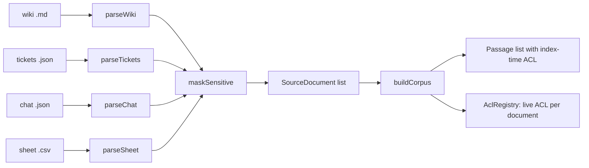

# Design: source stitching

## Overview

Each source kind has a pure adapter function that turns raw text into `SourceDocument` objects. A document holds metadata plus its passages. The corpus builder flattens documents into passages and snapshots each document's ACL (the "index-time ACL") for Gate 1. Masking runs inside the adapters, before text becomes a passage.



## Interfaces

```ts
type SourceKind = "wiki" | "ticket" | "chat" | "sheet";
interface Acl { groups: string[]; users: string[] }
interface SourceDocument {
  id: string; kind: SourceKind; title: string; sourceName: string;
  docKey: string; version: number; updatedAt: string; status: "active" | "superseded" | "archived";
  acl: Acl; passages: { location: string; text: string }[];
}
interface Passage {
  id: string; docId: string; kind: SourceKind; title: string; location: string; text: string;
  docKey: string; version: number; updatedAt: string; status: SourceDocument["status"]; acl: Acl;
}
interface AdapterResult { documents: SourceDocument[]; warnings: string[] }
```

Files: `src/engine/adapters/{wiki,tickets,chat,sheet,detect}.ts`, `src/engine/mask.ts`, `src/engine/corpus.ts`.

## Decisions

- A tiny front matter parser handles `key: value` and `key: [a, b]` lines only. Reason: a YAML dependency would be the only runtime dependency outside React, and the dataset needs no more than this.
- The CSV parser handles RFC 4180 quoting (quoted commas and doubled quotes). Reason: spreadsheet exports commonly quote currency values.
- `docKey` defaults to `id`. Two documents share a lineage only when they share a `docKey`. This is how ghost versions are found (see `ghost-versions`).
- Upload detection uses extension first, then JSON shape: an `issues` array means tickets, `channel` plus `messages` means chat.

## Error handling

- Adapters never throw on malformed content inside a valid file; they skip the bad record and add a warning.
- `detectAndParse` returns `{ ok: false, reason }` for rejected uploads so the UI can show the reason.

## Testing strategy

- `tests/engine/adapters.test.ts`: one test per acceptance criterion in requirements 1 to 4 and 6.
- `tests/engine/mask.test.ts`: Luhn-valid and invalid numbers, NRIC and FIN, plus a fast-check property that masked output never contains a Luhn-valid 13 to 19 digit run.
